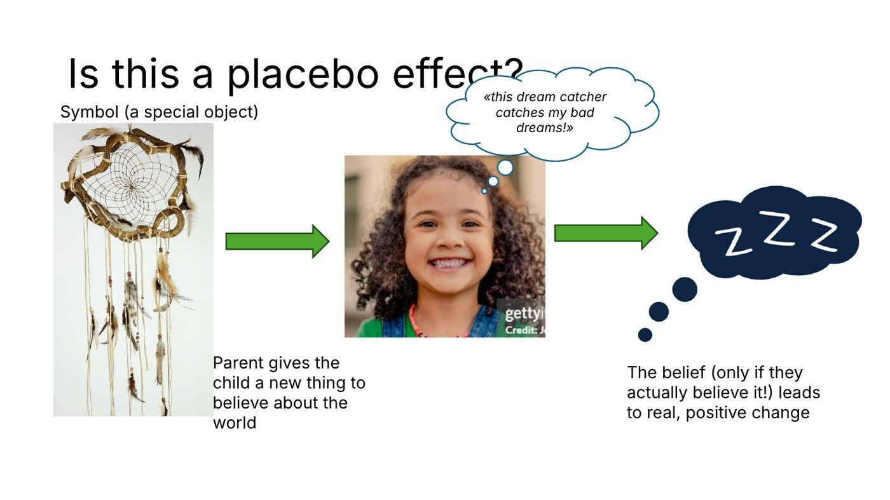
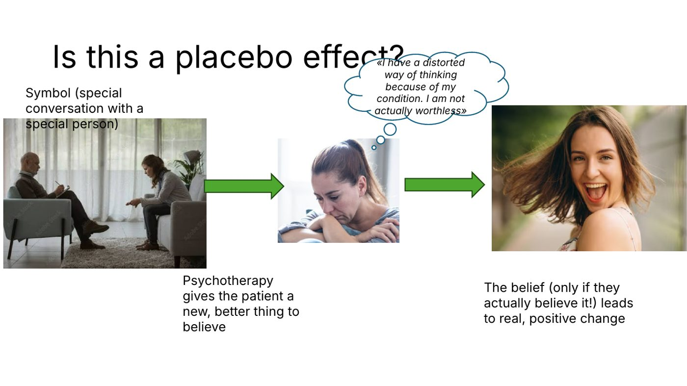

Quick check before we start: what do you believe about placebo? If your answer is
something like "the fake-pill effect, the thing good studies subtract out", same.
This post is me trying to blow that belief up a little.

## The thing we control for

The gold standard for asking "does this treatment work?" is the randomized controlled
trial (RCT). You split people randomly into two groups, give one group the real thing
(say, aspirin) and the other a placebo, and compare. Randomizing makes sure the groups
don't differ in anything else. The control group catches everything that would have
happened anyway, including the effect of simply *expecting* to get better. Whatever is
left over counts as the "real" effect.

So: how much of aspirin's effect is placebo? 10%? 35–40%? 50–65%?

It's the last one. That's not a rounding error. That's most of it.

## Psychedelics make it weirder

Psychedelic therapy (or transformational therapy) works differently from something like
an SSRI. SSRIs aim for continuous, gradual improvement. Psychedelic-assisted therapy aims
to *transform* maladaptive states into more adaptive ones through an altered state of
consciousness, an experience people often describe as one of the most meaningful of
their lives. In the brain, psilocybin looks nothing like placebo: brain regions suddenly
talk to each other in far more connected patterns.

And yet a big part of what makes it work seems to be what that experience *means* to the
person. Which raises the question I actually care about.

## Is this a placebo effect?

A kid can't sleep. A parent hangs a dream catcher over the bed and says: "this catches
your bad dreams." The kid believes it, and sleeps.

A symbol (a special object) gives the child a new thing to believe about the world, and
that belief leads to real, positive change. But only if they actually believe it.

<figure>
  
  <figcaption>Is this a placebo effect?</figcaption>
</figure>

Now psychotherapy. A symbol again, this time a special conversation with a special
person. The therapist offers the patient a new, better thing to believe: *"I have a
distorted way of thinking because of my condition. I am not actually worthless."* And if
the patient actually believes it, real, positive change follows.

<figure>
  
  <figcaption>And is this one?</figcaption>
</figure>

Same structure. It's no secret either: clients who believe therapy will help them tend to
do better. Hermeneutics would add that meaning always comes from a person's own
understanding, so it's always a matter of interpretation.

"Oh, but one is working towards the truth and one away from it!"

Is it, though? Look up depressive realism: depressed people often judge some things more
accurately, while healthy people overestimate how much control they have and run on
self-enhancing biases. Healthy minds aren't truth machines. So, honestly, who cares, bruh.
The question isn't whether a belief is true, it's whether it helps.

## Mental illness as maladaptive beliefs

Phobias, attachment trauma, schizophrenia, depression, OCD: a lot of mental illness can be
described as *maladaptive meaning-making*. Organism and environment interact, beliefs
emerge from that, and those beliefs then constrain how we live.

Dude, if we could only *get* people to believe the healthy things, psychotherapy would be
easy asf.

Look at cognitive behavioural therapy. It officially changes "thoughts and behaviour", and
it hates the word *belief*. But it's literally trying to change beliefs:

| Situation                    | Belief                          | New, balanced belief                                  |
|------------------------------|---------------------------------|-------------------------------------------------------|
| You make a mistake at work   | "I'm incompetent."              | "I made one mistake. I can correct it and learn from it." |
| A friend hasn't replied      | "They must be angry with me."   | "I don't know why they haven't replied. I can wait or check in." |
| You're rejected for a job    | "I'll never succeed."           | "This application didn't work out. It doesn't predict every future one." |

## Direction and strength

A belief has two parts: its **direction** (the content, *what* you believe) and its
**strength** (*how much* you believe it). A strong belief has stronger effects.

That's also why a line like "this is just a thought" can work so well. You're not arguing
with the content at all; you're weakening its strength, and the belief loses its power.

## What I wanna say

- **Placebo isn't some random side effect.** It's tangled up with meaning and belief,
  which are central mechanisms in psychology, and in being human.
- **Belief has direction and strength, and together they shape outcomes.** That deserves
  to be studied and targeted, not labelled as some esoteric thing we don't take seriously.
- **Take symbolic, meaningful things seriously,** not only the "objective, measurable"
  ones. Humans aren't purely objective and measurable.
- **RCTs aren't built for this.** Meaning-making only works consciously and within a
  context, so subtracting the "placebo" removes exactly the part I'm interested in.

Which leaves me with the real brainf\*ck: should we start thinking about psychological
healing as *helping people become able to truly believe the adaptive things?*

Maybe that's what rituals are for. A transition ritual is a meaningful event in someone's
own story, and novelty makes us more open to adopting new beliefs. Maybe that's a way to
help people believe change is possible.

## But

We still have to be careful to target the roots of things. Painkillers aren't true
healing. If we use placebo-like effects on purpose, they should help with real healing,
not just make the symptoms quieter.

## ?

I'm more confused than before all of this, and I hope you are too. I'm happy to hear your
thoughts.
