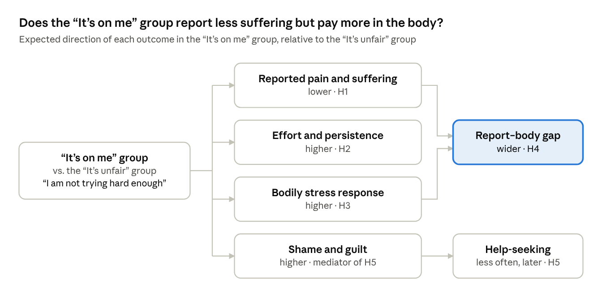

> **Core question:** When a difficulty is caused from the outside, is coping by
> reappraising it and attributing it to oneself ("I'm not trying hard enough") real
> resilience, or a suppression whose costs self-reports don't show?

## Background

Cognitive coping is usually seen as a resource. Strong reappraisal ability, the skill of
reinterpreting a situation so that it feels different, buffers the effect of stress on
depression (Troy et al., 2010). Attributing difficulty to internal, controllable causes such
as effort is also considered adaptive, because it implies the outcome can be changed by
trying harder (Weiner, 1985).

**But some difficulties are caused from the outside.** At the root, these can only be
resolved by external action: problem-focused coping, which changes the situation, rather
than emotion-focused coping, which changes one's response to it (Lazarus & Folkman, 1984).
Strong cognitive skills may still let people cope, but the cause stays in place, and I
suspect this may ultimately be worse than solving the problem at its root. Consistent with
this, higher reappraisal ability went with fewer depressive symptoms under uncontrollable
stress (such as a partner's illness), but more symptoms under controllable stress (such as
problems at work) (Troy, Shallcross & Mauss, 2013).

**Self-reports may miss the cost.** The evidence that these skills are a resource rests
mostly on self-reported distress. I want to find out whether coping can lower reported
distress while the body keeps paying; if so, self-report alone would mistake strain for
resilience.

## Study design

Real situations are ambiguous. They rarely sort cleanly into personal responsibility or
structural unfairness; mostly both apply at once, and both readings have benefits. In
everyday life, the appraisal and the situation therefore vary together, and their effects
can't be separated. The study holds the situation constant and induces the appraisal
experimentally: both groups face the same, equally unfair difficulty and differ only in how
it is framed.

|                   | "It's on me" group (internal)   | "It's unfair" group (external)  |
|-------------------|---------------------------------|---------------------------------|
| Unfairness        | Unknown to participants         | Known to participants           |
| Induced appraisal | "I am not trying hard enough"   | "The situation is just unfair"  |

## Hypotheses

### What prior work suggests

- **H1: Suffering.** I expect the "It's unfair" group to report more pain and suffering
  caused by the difficulty. Identical harms hurt more when seen as intentional (Gray &
  Wegner, 2008), and perceived injustice predicts worse pain outcomes (Sullivan et al., 2008).
- **H2: Effort.** I expect the "It's on me" group to try harder, investing more effort and
  persisting longer, since attributing failure to a lack of effort sustains persistence
  (Dweck, 1975; Weiner, 1985).

### What I want to test

- **H3: Bodily cost.** Does the "It's on me" group show a stronger physiological stress
  response, for example cardiovascular, hormonal or inflammatory strain? This seems
  plausible, since inducing self-blame has been shown to raise shame and proinflammatory
  activity (Dickerson et al., 2004).
- **H4: Widening gap.** Do reported suffering and bodily cost drift further apart in the
  "It's on me" group? This is where resilience and masked strain can be told apart. If both
  are low, the coping looks genuinely resilient; if only the report is low, it may be a less
  healthy suppression masked by a coping style. Either result would be informative.
  Self-report and physiology are known to diverge (Weinberger et al., 1979; Gross &
  Levenson, 1993).
- **H5: Help-seeking.** Does the "It's on me" group seek help less or later, and do shame
  and guilt explain this? One possible reason: if the problem feels self-caused, asking for
  help may feel like admitting failure. Receiving help can threaten self-esteem (Nadler &
  Fisher, 1986), and seeking it carries self-stigma (Vogel et al., 2006).

<figure>
  
  <figcaption>Predicted model · five hypotheses</figcaption>
</figure>

## Relevance

If these effects hold, one mechanism could help explain several known phenomena. In each,
an internal appraisal of an external or unrecognised difficulty seems to keep people
functioning, while the costs may stay hidden and surface later.

- **Late ADHD and autism diagnosis.** Many people spend years thinking "I just need to try
  harder, this is normal", which keeps them going. Diagnosis shifts this to "I have a
  condition, it's not my fault, and I deserve help": the appraisal switches from internal to
  external. Many feel relief, but also anger and grief that was not there before (Young et
  al., 2008; Leedham et al., 2020), a reaction one study called a "not guilty verdict"
  (Punshon et al., 2009). For some, functioning suddenly stops: a decompensation, meaning a
  breakdown of coping that had held until then, resembling autistic burnout (Raymaker et
  al., 2020).
- **Disadvantaged groups.** Under structural disadvantage, competence and self-control
  predict good psychosocial outcomes, but also more physiological wear and tear (allostatic
  load) and faster biological aging of cells (epigenetic aging). The authors call this
  resilience "skin deep": visible on the surface, but not in the body (Brody et al., 2013;
  Miller et al., 2015).
- **Adverse childhood.** People who grew up in adverse circumstances often carry
  self-blame, guilt and shame. In that environment self-blame was adaptive: "it was my
  fault" preserves a sense of control, which is less frightening than helplessness
  (Janoff-Bulman, 1979). Healing often comes from realising the situation was unfair; only
  then can grief and anger surface (Herman, 1992).

## References

- Brody, G. H., Yu, T., Chen, E., Miller, G. E., Kogan, S. M., & Beach, S. R. H. (2013). Is resilience only skin deep? Rural African Americans' socioeconomic status–related risk and competence in preadolescence and psychological adjustment and allostatic load at age 19. *Psychological Science, 24*(7), 1285–1293. <https://doi.org/10.1177/0956797612471954>
- Dickerson, S. S., Kemeny, M. E., Aziz, N., Kim, K. H., & Fahey, J. L. (2004). Immunological effects of induced shame and guilt. *Psychosomatic Medicine, 66*(1), 124–131.
- Dweck, C. S. (1975). The role of expectations and attributions in the alleviation of learned helplessness. *Journal of Personality and Social Psychology, 31*(4), 674–685.
- Gray, K., & Wegner, D. M. (2008). The sting of intentional pain. *Psychological Science, 19*(12), 1260–1262. <https://doi.org/10.1111/j.1467-9280.2008.02208.x>
- Gross, J. J., & Levenson, R. W. (1993). Emotional suppression: Physiology, self-report, and expressive behavior. *Journal of Personality and Social Psychology, 64*(6), 970–986. <https://doi.org/10.1037/0022-3514.64.6.970>
- Herman, J. L. (1992). *Trauma and recovery.* Basic Books.
- Janoff-Bulman, R. (1979). Characterological versus behavioral self-blame: Inquiries into depression and rape. *Journal of Personality and Social Psychology, 37*(10), 1798–1809. <https://doi.org/10.1037/0022-3514.37.10.1798>
- Lazarus, R. S., & Folkman, S. (1984). *Stress, appraisal, and coping.* Springer.
- Leedham, A., Thompson, A. R., Smith, R., & Freeth, M. (2020). 'I was exhausted trying to figure it out': The experiences of females receiving an autism diagnosis in middle to late adulthood. *Autism, 24*(1), 135–146. <https://doi.org/10.1177/1362361319853442>
- Miller, G. E., Yu, T., Chen, E., & Brody, G. H. (2015). Self-control forecasts better psychosocial outcomes but faster epigenetic aging in low-SES youth. *Proceedings of the National Academy of Sciences, 112*(33), 10325–10330. <https://doi.org/10.1073/pnas.1505063112>
- Nadler, A., & Fisher, J. D. (1986). The role of threat to self-esteem and perceived control in recipient reaction to help: Theory development and empirical validation. *Advances in Experimental Social Psychology, 19*, 81–122.
- Punshon, C., Skirrow, P., & Murphy, G. (2009). The 'not guilty verdict': Psychological reactions to a diagnosis of Asperger syndrome in adulthood. *Autism, 13*(3), 265–283.
- Raymaker, D. M., Teo, A. R., Steckler, N. A., Lentz, B., Scharer, M., Delos Santos, A., Kapp, S. K., Hunter, M., Joyce, A., & Nicolaidis, C. (2020). "Having all of your internal resources exhausted beyond measure and being left with no clean-up crew": Defining autistic burnout. *Autism in Adulthood, 2*(2), 132–143.
- Sullivan, M. J. L., Adams, H., Horan, S., Maher, D., Boland, D., & Gross, R. (2008). The role of perceived injustice in the experience of chronic pain and disability: Scale development and validation. *Journal of Occupational Rehabilitation, 18*(3), 249–261.
- Troy, A. S., Shallcross, A. J., & Mauss, I. B. (2013). A person-by-situation approach to emotion regulation: Cognitive reappraisal can either help or hurt, depending on the context. *Psychological Science, 24*(12), 2505–2514. <https://doi.org/10.1177/0956797613496434>
- Troy, A. S., Wilhelm, F. H., Shallcross, A. J., & Mauss, I. B. (2010). Seeing the silver lining: Cognitive reappraisal ability moderates the relationship between stress and depressive symptoms. *Emotion, 10*(6), 783–795. <https://doi.org/10.1037/a0020262>
- Vogel, D. L., Wade, N. G., & Haake, S. (2006). Measuring the self-stigma associated with seeking psychological help. *Journal of Counseling Psychology, 53*(3), 325–337. <https://doi.org/10.1037/0022-0167.53.3.325>
- Weinberger, D. A., Schwartz, G. E., & Davidson, R. J. (1979). Low-anxious, high-anxious, and repressive coping styles: Psychometric patterns and behavioral and physiological responses to stress. *Journal of Abnormal Psychology, 88*(4), 369–380. <https://doi.org/10.1037/0021-843X.88.4.369>
- Weiner, B. (1985). An attributional theory of achievement motivation and emotion. *Psychological Review, 92*(4), 548–573. <https://doi.org/10.1037/0033-295X.92.4.548>
- Young, S., Bramham, J., Gray, K., & Rose, E. (2008). The experience of receiving a diagnosis and treatment of ADHD in adulthood: A qualitative study of clinically referred patients using interpretative phenomenological analysis. *Journal of Attention Disorders, 11*(4), 493–503.

